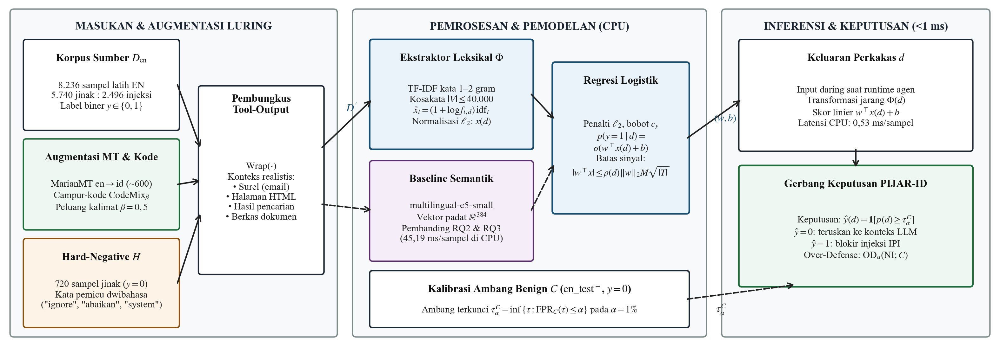

# PIJAR-ID — Indonesian & Code-Mixed Indirect Prompt Injection Detection on CPU

Reproducibility artifact for the paper:

> **PIJAR-ID: Deteksi *Indirect Prompt Injection* Bahasa Indonesia dan Campur-Kode di CPU melalui Pemodelan Leksikal yang Diperkuat Augmentasi Terjemahan**
> Gilang Wasis Wicaksono, Vera Suryani — School of Computing, Telkom University.

**PIJAR-ID** = *Prompt-Injection detection via Augmentation-Robust lexical modeling for Indonesian*. It is a sub-millisecond, CPU-only guardrail that flags **indirect prompt injection (IPI)** hidden inside tool outputs (email, HTML, search results, files) *before* an LLM agent consumes them. It combines **word TF-IDF (1–2 gram) + L2 logistic regression** with two training-time operators — **machine-translation augmentation (MarianMT en→id + sentence-level code-mixing)** and **NotInject-style bilingual hard-negatives** — and beats a production transformer guard (ProtectAI DeBERTa-v3) on every *out-of-domain* axis at ~900× lower latency.

> ⚠️ **Scope / safety.** This is a *defensive detector* and a research artifact. It ships our own derived Indonesian corpus and all result ledgers; it does **not** redistribute the third-party public datasets it was trained/evaluated on — see [`expD/data/README.md`](expD/data/README.md) to fetch those.

---

## 1. Headline result (why this repo exists)

One cheap lexical model, made robust by two training-time operators, dominates a 184M-parameter production guard on the axes that matter for deployment — **cross-benchmark EN, cross-lingual ID, over-defense, attack recall** — while running on a CPU in half a millisecond.

| Axis (held-out, zero-shot) | ProtectAI DeBERTa-v3 | multilingual-e5 + LR | **PIJAR-ID (ours)** |
|---|---|---|---|
| deepset — cross-benchmark EN · TPR@1%FPR (AUROC) | 0.133 (0.741) | 0.133 (0.740) | **0.767 (0.968)** |
| id_test — cross-lingual ID · TPR@1%FPR (AUROC) | 0.104 (0.673) | 0.864 (0.990) | **0.948 (0.998)** |
| NotInject — over-defense FPR ↓ | 0.242 | 0.324 | **0.136** |
| gandalf — attack recall ↑ | 0.880 | 0.912 | **0.947** |
| CPU latency (ms/sample) ↓ | 476.0 | 45.19 | **0.53** |

*(5-seed means; std < 0.001. Source files: `expD/results/baseline_tf.json`, `iter2.json`, `latency.json`.)*

**Honesty note.** On the *in-domain* `en_test` axis PIJAR-ID is trained in-domain while the guard runs zero-shot, so that comparison is **not fair to the guard** and is excluded from our superiority claim. All claims above are on held-out, equally zero-shot axes.

---

## 2. The method in one diagram



- **Training branch (offline, once):** the public EN injection corpus is enriched with MarianMT en→id translations, sentence-level EN/ID code-mixing (β=0.5), and 720 bilingual hard-negatives, all wrapped into tool-output contexts, then a sublinear word TF-IDF + L2 logistic regression is fit.
- **Inference branch (online, <1 ms):** only TF-IDF transform + a logistic dot product + a threshold calibrated to 1% FPR. No neural encoder at inference → `O(|T(d)|)` per-token, auditable.

### Why it works — the *Vocabulary-Coverage Collapse* argument

A pure lexical detector's discriminative signal is bounded by how much of a document's vocabulary it has seen:

```
|wᵀx(d)|  ≤  ρ(d) · ‖w‖₂ · M·√|T(d)|        (paper Eq. 9)
```

where `ρ(d)` = in-vocabulary coverage ratio. Under a language shift EN→ID, out-of-vocabulary (OOV) rises and `ρ(d)→0`, so the score collapses to the bias term `σ(b)` (random guessing). We measured OOV rising **0.126 (en_test) → 0.251 (deepset) → 0.463 (id_test)** — which directly predicts the lexical ID collapse to TPR@1%FPR ≈ 0.488. The fix is *not* a bigger model but **vocabulary coverage**: MT-augmentation raises `ρ(d)` and recovers ID TPR@1%FPR from 0.488 → 0.948.

---

## 3. Repository map

```
.
├── README.md               ← you are here (method + results + how to run)
├── REPRODUCE.md            ← step-by-step to regenerate every table/number
├── LITERATUR_IPI.md        ← competitor/literature mapping (paper Table I)
├── requirements.txt
├── common/
│   └── metrics.py          ← TPR@fixed-FPR, AUROC, bootstrap CI, ECE (single source of truth)
├── expD/
│   ├── src/                ← all pipeline code (see §4)
│   ├── data/               ← OUR released artifacts + data/README.md (fetch public sets)
│   └── results/            ← 5-seed JSON ledgers + FINDINGS.md (numbers in the paper)
└── figs/                   ← figures used in the paper
```

## 4. What each script does (code → paper)

| Script | Role | Paper anchor |
|---|---|---|
| `expD/src/features.py` | sublinear word TF-IDF (1–2 gram, 40k, ℓ2) + cached e5 embeddings | Eq. (1) |
| `expD/src/tooloutput.py` | wraps raw text into email/HTML/search/file **tool-output contexts** | §III-A, BIPIA-style |
| `expD/src/build_corpus.py` | normalizes raw public datasets → `(text,label,source)` + wrapping | §IV-A |
| `expD/src/id_build_mt.py` | MarianMT en→id + code-mix → `id_test`, `id_train_aug`, `id_spotcheck` | Eq. (10), Alg. 1 |
| `expD/src/hardneg.py` | generates 720 NotInject-style bilingual benign-with-trigger hard-negatives | §III-E |
| `expD/src/run_detectors.py` | fits tfidf_lr / e5_lr / e5_mlp / e5_hgb, 5 seeds | Table II |
| `expD/src/iter2.py` | **main ablation**: base → +aug → +aug+hardneg (PIJAR-ID), 5 seeds | **Table III** |
| `expD/src/baseline_tf.py` | zero-shot ProtectAI DeBERTa-v3 guard on CPU (head-to-head) | **Table IV** |
| `expD/src/fuse.py` | word+char+e5 fusion experiment — **rejected** (dilutes word signal) | §V-B |
| `expD/src/latency.py` | end-to-end CPU latency (feature transform + classify) | Table IV, last row |
| `expD/src/analyze.py` | TPR@FPR, AUROC, over-defense at calibrated threshold, McNemar | §IV–V |

## 5. Released data artifacts (ours)

| File | Rows | What it is |
|---|---|---|
| `expD/data/id_test.csv` | 500 | Indonesian IPI test set: 250 full-translation + 250 code-mix, wrapped (`context` col). Cross-lingual axis. |
| `expD/data/id_test_raw.csv` | 500 | same, pre-wrapping (`text`,`label`,`source`,`en_source`) |
| `expD/data/id_train_aug.csv` | 600 | MT-translated balanced training augmentation |
| `expD/data/id_spotcheck.csv` | 40 | manually audited subset (translation-validity evidence) |
| `expD/data/hardneg.csv` | 720 | bilingual benign-with-trigger hard-negatives (over-defense fix) |

The third-party **public** corpora (safe-guard EN train/test, deepset, gandalf, NotInject) are **not** redistributed here. Fetch + rebuild instructions: [`expD/data/README.md`](expD/data/README.md).

## 6. Quick start

```bash
pip install -r requirements.txt
# inspect the headline numbers without retraining:
cat expD/results/iter2.json          # Table III ablation (base / aug / PIJAR-ID)
cat expD/results/baseline_tf.json    # Table IV guard head-to-head
```
Full regeneration (fetch public data → build → train → evaluate): see **[REPRODUCE.md](REPRODUCE.md)**.

## 7. Limitations (stated plainly)

1. `id_test` is **synthetically** generated (MarianMT + code-mix rules) from EN prompts, with 40 rows human-audited. An organically human-authored Indonesian IPI benchmark is future work.
2. The in-domain `en_test` comparison favors in-domain-trained models; superiority claims are confined to the zero-shot axes.
3. `deepset` has only 56 benign samples, so TPR@1%FPR there is a small-sample point estimate — we report TPR@5%FPR and AUROC alongside it.

## 8. Citation

```bibtex
@inproceedings{wicaksono_pijarid_2026,
  title     = {PIJAR-ID: Deteksi Indirect Prompt Injection Bahasa Indonesia dan Campur-Kode di CPU melalui Pemodelan Leksikal yang Diperkuat Augmentasi Terjemahan},
  author    = {Wicaksono, Gilang Wasis and Suryani, Vera},
  booktitle = {(under review)},
  year      = {2026}
}
```

## License

Code and released artifacts: **MIT** (see [LICENSE](LICENSE)). The third-party datasets referenced in `expD/data/README.md` remain under their own licenses.
